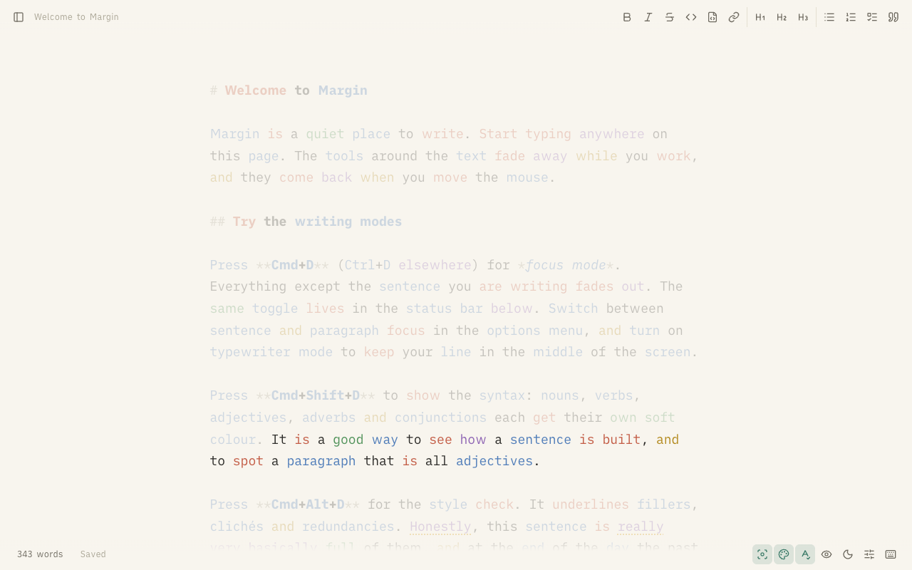
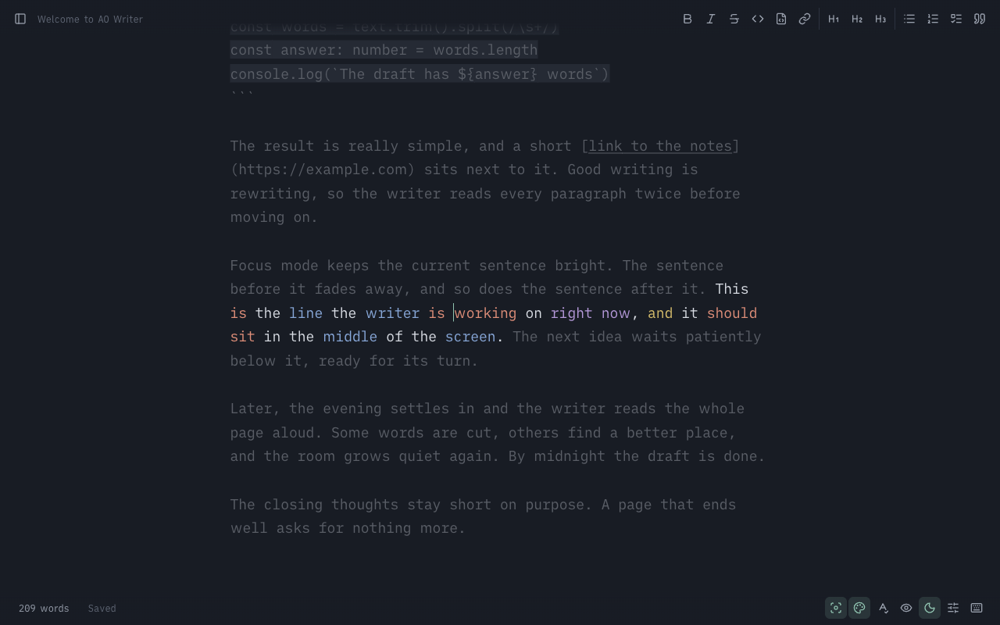

# AO Writer

A quiet Markdown writer for the browser. One centred column of text, the tools out of the way, and a few
writing aids you switch on when you want them: focus mode, syntax highlight, style check and a live preview.
Everything you write stays in your browser (OPFS, with an IndexedDB fallback). There is no server and no account.

AO Writer is an **original, clean-room implementation** inspired by the feature set of iA Writer. It contains no
code, word lists, colours, CSS or icons from that app; the part-of-speech tagger, the style lists and the
Markdown renderer are written from scratch for this repo. The feature list is in [`docs/SPEC.md`](docs/SPEC.md).



More screenshots (dark and light, typewriter, split and full preview, library, options) are in
[`docs/screenshots`](docs/screenshots).

## Run it

```sh
pnpm install
pnpm dev          # http://localhost:5190
pnpm build        # SPA in dist/client (serve _shell.html as the fallback page)
pnpm preview      # serve the build on :5190
```

| Command | What it does |
| --- | --- |
| `pnpm check` | typecheck, oxlint (zero warnings), Vitest, knip |
| `pnpm test` | unit tests (tagger accuracy, focus ranges, Markdown, storage, shortcuts, Vim keys) |
| `pnpm e2e` | Playwright tests against the dev server (installs nothing; run `pnpm exec playwright install chromium` once) |
| `pnpm lint` | `oxlint --deny-warnings` with the anti-slop rules in `tools/oxlint/anti-slop` |

## Features and shortcuts

On macOS the main modifier is Cmd; on Windows and Linux it is Ctrl. Every action is also a button in the top
bar, the status bar or the options menu, so nothing depends on a shortcut. Some browsers keep a few combinations
for themselves (Cmd+1..6 and Cmd+L in Chrome, for example), so headings, lists and links have second shortcuts
(shown in the keyboard list).

| Feature | macOS | Windows / Linux |
| --- | --- | --- |
| Focus mode (sentence or paragraph, set in Options) | Cmd+D | Ctrl+D |
| Syntax highlight (nouns, verbs, adjectives, adverbs, conjunctions) | Cmd+Shift+D | Ctrl+Shift+D |
| Style check (fillers, clichés, redundancies) | Cmd+Alt+D | Ctrl+Alt+D |
| Preview | Cmd+R | Ctrl+R |
| Split or full preview | Cmd+Shift+R | Ctrl+Shift+R |
| Dark appearance | Cmd+Ctrl+N | Ctrl+Alt+N |
| Text bigger / smaller / normal | Cmd+= / Cmd+- / Cmd+0 | Ctrl+= / Ctrl+- / Ctrl+0 |
| Library sidebar | Cmd+Ctrl+S | Ctrl+Alt+S |
| New document | Alt+Shift+N | Alt+Shift+N |
| Bold / italic / strikethrough | Cmd+B / Cmd+I / Cmd+Alt+U | Ctrl+B / Ctrl+I / Ctrl+Alt+U |
| Code / code block | Cmd+J / Cmd+Shift+J | Ctrl+J / Ctrl+Shift+J |
| Headings 1 to 6 | Cmd+1..6 (or Cmd+Alt+1..6) | Ctrl+1..6 (or Ctrl+Alt+1..6) |
| List / ordered list / task list | Cmd+L / Cmd+Shift+L / Cmd+Alt+L | Ctrl+L / Ctrl+Shift+L / Ctrl+Alt+L |
| Blockquote | Cmd+Shift+. | Ctrl+Shift+. |
| Link | Cmd+K | Ctrl+K |
| Mark task completed | Cmd+Alt+X | Ctrl+Alt+X |

## Code highlighting

Fenced code blocks with a language are coloured with [Shiki](https://shiki.style), in the editor and in the
preview, in both themes (`vitesse-light` and `github-dark-dimmed`). Switching the theme only swaps a CSS
variable, so nothing is re-tokenised.

````md
```ts
const answer: number = 42
```
````

Supported languages (and their aliases): `ts` (`typescript`), `tsx`, `js` (`javascript`), `jsx`, `json`, `html`,
`css`, `vue`, `bash` (`sh`, `shell`, `zsh`), `python` (`py`), `rust` (`rs`), `go`, `sql`, `yaml` (`yml`),
`markdown` (`md`) and `diff`. Any other language, and fences without one, stay plain code.

Shiki is loaded lazily: it uses the fine-grained `shiki/core` build with the JavaScript regex engine (no
WebAssembly), and each grammar is its own chunk that is fetched the first time a fence uses it. A document
without a supported fence never loads any of it. In the editor only the colour changes (never weight, style
or size), so the overlay stays aligned with the textarea; tokens arrive about 120 ms after you stop typing,
are cached per block (language and code), and a block that is still waiting keeps the plain code styling.
Parts-of-speech and style-check colouring skip code, as before.

## Vim keybindings

Optional and off by default. Switch them on under Options, Keys; the setting is saved with the others. The status
bar then shows the mode (`NORMAL`, `INSERT`, `VISUAL` or `VISUAL LINE`, plus any count or operator still waiting for its motion),
normal and visual mode draw a block cursor, and every new or switched document starts in normal mode. Edits go
through the same path as typing, so the browser's own undo keeps working.

| Keys | What they do |
| --- | --- |
| `h` `j` `k` `l`, arrows | Left, down, up, right. `j` and `k` move by wrapped row, like `gj` and `gk`, and keep their column across rows |
| `w` `b` `e` `ge` | Word forward, word back, end of word, end of the word before (a run of punctuation is a word, and so is an empty line) |
| `W` `B` `E` `gE` | The same for WORDs, which end only at a blank (`a.b` is one WORD); `dW` and `cW` bend like `dw` and `cw` |
| `%` | Jump to the partner of the first bracket at or after the cursor on the line (`(` `)` `[` `]` `{` `}`), across lines; `d%` deletes through it |
| `/` `?` + text, Enter | Search forward or back; the query shows in the status bar as you type (Backspace takes a character away, Esc cancels). Plain text, not a regex; a query without capitals ignores case (Vim's `smartcase`); wraps around the end. Works as a motion (`d/foo`) and in visual mode |
| `n` `N` `*` `#` | Next or previous match of the last search; `*` and `#` search the whole word under the cursor forward or back |
| `0` `^` `$` | Start of line, first non-blank, end of line |
| `J` `K` | Jump 10 rows down or up (by wrapped row, like `10j` / `10k`; `2J` jumps 20, `dJ` deletes 11 lines). Replaces Vim's join-lines `J` and keyword-lookup `K` |
| `f` `F` `t` `T` + char | Find a character on the current line: `f` and `F` land on the next or previous one, `t` and `T` stop just before or after it; `3fa` goes to the third `a`. Any single key is a character (space, punctuation, `ü`). Nothing is found on other lines, and a miss neither moves nor, after an operator, deletes |
| `;` `,` | Repeat the last find in the same or the opposite direction; after `t` or `T` a match right next to the cursor is skipped, so the cursor keeps going |
| `gg` `G` | First and last line; with a count, that line (`3G`) |
| `2w` `3l` `5j` | Counts work for motions, for operators (`2dd`, `d3w`) and for `p` |
| `d` `c` `y` + motion | Delete, change (delete and insert), yank; `dd` `cc` `yy` act on lines, `dw` `cw` `d$` `dj` on a range; `dfx` `dt.` `cf)` `yFx` work too (`f` and `t` reach through their target, `F` and `T` stop in front of it) |
| `i` `a` + object after `d` `c` `y` or in visual mode | Text objects: `iw` `aw` word, `iW` `aW` WORD (anything between blanks), `is` `as` sentence, `ip` `ap` paragraph (whole lines), `i"` `a"` `i'` `a'` `` i` `` `` a` `` quotes on the line, `i(` `a(` (also `)` `b`), `i[` `a[`, `i{` `a{` (also `}` `B`), `i<` `a<`, `it` `at` HTML tag. `i` takes the inside, `a` adds the blanks, quotes or brackets around it. A count takes more words or reaches further out (`d2i(`). Outside every pair of quotes or brackets, the next pair on the line counts, so `ci"` and `ci(` work from in front of it. In visual mode `viw` selects, `vawaw` adds a word, `vi(i(` takes the next pair out, `vip` turns linewise |
| `r` + char | Replace the character under the cursor (`3rx` three of them; `r` Enter breaks the line); in visual mode every selected character |
| `~` | Turn the case of the character round and move on (`3~`); in visual mode `~` `u` `U` toggle, lower or upper the selection |
| `>>` `<<`, `>` `<` + motion | Indent or outdent lines by four spaces (enough to nest any Markdown list); `<` takes up to four spaces or a tab. `3>>`, `>ip`, `>G`, and `>` `<` on a visual selection |
| `.` | Repeat the last change at the cursor, typed text included (`cw` + text, `A` + text, `dd`, `x`, `r`, `>>`, `di"`, ...). `3.` swaps in a new count. The repeat is one edit, so one `u` takes it back. Changes made in visual mode are not repeated |
| `x` `X` `D` `C` `s` `S` `Y` | `dl`, `dh`, `d$`, `c$`, `cl`, `cc`, `yy` |
| `p` `P` | Paste after or before the cursor; a yanked line is pasted as a line |
| `i` `a` `I` `A` `o` `O` | Insert before or after the cursor, at the first non-blank or the end of the line, on a new line below or above |
| `v` | Visual mode (characters). Motions extend the selection; `d` `x` `c` `y` act on it; `o` swaps its ends; `v` or Esc leaves |
| `V` | Linewise visual mode. The selection always covers whole lines and `j` `k` move by logical line; `d` `x` delete the lines, `y` yanks them (so `p` and `P` paste lines), `c` replaces them with an empty line; `o` swaps the ends, `V` or Esc leaves |
| `v` in `V`, `V` in `v` | Switch between the two kinds of selection, keeping anchor and cursor |
| `p` `P` in visual mode | Replace the selection with the register. `p` leaves the replaced text in the register, `P` keeps the register as it was (Vim 9) |
| `u`, Ctrl+R | Undo, redo (the browser's history) |
| Esc, Ctrl+[ | Back to normal mode |

Yanks are also written to the system clipboard when the browser allows it. In normal and visual mode no letter
types into the document, but Cmd/Ctrl chords (Bold, Preview, copy, paste) still work. Ctrl+R is redo in normal and
visual mode and the preview shortcut in insert mode (on a Mac the preview stays on Cmd+R). With an operator, `j`
and `k` act on whole logical lines, as in Vim. Not included: regex search, named registers,
`:` commands, macros, blockwise visual mode (`Ctrl+V`).

Other behaviour: Enter continues lists, task lists and quotes (and leaves them on an empty item); the status bar counter cycles through words, characters,
reading time (220 wpm) and speaking time (150 wpm) when you click it, and counts the selection while text is
selected; the chrome fades while you type and returns when the mouse moves; documents autosave 500 ms after
the last keystroke (and when the tab hides).

## Focus and typewriter

Focus mode works like iA Writer's. It has three scopes in the options menu: **Sentence**, **Paragraph** and **Typewriter**
(centring only, nothing dimmed). Turning focus on also turns typewriter scrolling on and centres the caret line at once;
turning focus off gives back whatever typewriter setting you had (the setting itself is never changed: the editor reads
`typewriter || focus`). While focus is on, the "Typewriter scrolling" box shows as checked and fixed.

Everything outside the scope is one flat tone: the text colour mixed 38% (dark) or 42% (light) into the page colour with
`color-mix` in OKLab. There is no opacity, so nothing blends, and the tone replaces every inner colour: Markdown marks,
headings, links, part-of-speech colours, Shiki code colours and style-check underlines. Weights and italics stay. Dimmed
text switches at once, with no fade. In dark mode that is about rgb(89, 94, 103) on rgb(23, 28, 37), a 2.6:1 contrast, as
iA's rgb(92, 92, 92) on rgb(25, 25, 25).

The sentence is found with the browser's `Intl.Segmenter` (ICU sentence rules, for the browser's language), applied to
the caret's paragraph only. ICU keeps `3.14`, `e.g. the` and `U.S. now` inside a sentence, and a full stop followed by a
lowercase word does not end one, but it has no abbreviation list: a title or initial followed by a capital (`Dr. Smith`,
`z. B.`) ends the sentence. Paragraph scope is the block between blank lines, with each list item, heading and quote
line as its own block.

Typewriter scrolling re-centres the caret line on every selection change, with a 150 ms ease-out glide on the scroll
position (a jump when the system asks for reduced motion). A caret line already within 3% of the window height from
the middle stays put. Keys and Vim motions scroll immediately; a mouse click or drag waits 150 ms after the button
comes up. The page has half a window of padding above and below, so the first and last line can be centred.
Without typewriter scrolling the page only scrolls when the caret comes within 96 px of an edge.



## Learn English

Open **Learn English** with the graduation-cap button in the top bar, or the **Learn** tab in the sidebar.
Add an English word with its German meaning and an optional example, or choose **Prepare with coach** to generate
the meaning and example. Words from the coach's existing word book can also be added to practice.

Enable **Learn from corrections I accept** to save English spelling corrections when you run **Fix spelling and grammar**.
Only corrections actually applied outside code are captured. Repeated misspellings update one entry, keep the original
misspellings and correction count, and make that word due again. This first version trains spelling and vocabulary;
grammar corrections still work in the editor but do not become practice cards.

Sessions contain up to five due words, showing a German cue and an example with the answer hidden. Type the English
word, get feedback, and retry difficult spellings. A correct first answer schedules reviews after 1, 3, 7, 14, then 30 days;
wrong or revealed answers return tomorrow, and retries do not count as unaided recall. Remove unwanted words from the
practice book. Vocabulary prompts currently check the saved target word, ignoring case and outer whitespace.

Practice cards, the capture preference and review progress are saved in this browser independently of the server's
Markdown word book. Practice and manual entry work without the AI server; generating German prompts and fixing text
need `pnpm dev` and a Claude Code login. Browser data does not sync between browsers and is removed if site data is cleared.

## How it works

- **Editor**: a `<textarea>` (it owns input, selection, IME and undo) over a transparent-text highlight layer
  with identical font metrics. The layer is built from pure functions in `src/core`; the Markdown styling
  never changes size, only weight and colour, so the two layers stay aligned. Vim mode is a layer in front of
  the textarea's key handler: `core/vim` turns a key into a result (move, edit, undo, ...) and `app/vim-input.ts`
  applies it; wrapped-row moves are measured on the highlight layer in `app/vim-rows.ts`.
- **`src/core`**: framework-free TypeScript with unit tests: `pos/` (lexicon + suffix rules + context rules
  tagger), `style/` (word lists and a phrase matcher), `markdown/` (live-styling ranges, safe HTML renderer,
  format edits, the colour-token types of fenced code), `text/` (counts, sentence and paragraph detection), `editor/typewriter.ts` (the typewriter scroll maths), `vim/` (key → result: motions,
  operators, registers; no DOM), `shortcuts.ts`.
- **`src/features`**: Effect 4 services and atoms. `library/storage.ts` is the `DocumentStorage` service (OPFS
  layer with an IndexedDB fallback and an in-memory layer for tests), `library/atoms.ts` holds the documents,
  the debounced autosave and the library actions, `settings/` is the persisted settings atom, `highlight/` is the
  `CodeHighlighter` service (lazy Shiki, per-block cache) and the atom that keeps the code tokens of the editor and the preview up to date.
- **`src/app`**: React 19 components on TanStack Start (SPA mode) and Tailwind 4.

## Fonts

The typefaces are [iA Writer Duo, Mono and Quattro](https://github.com/iaolo/iA-Fonts) by Information
Architects Inc. (based on IBM Plex), used under the SIL Open Font License 1.1. The license text is in
[`public/fonts/LICENSE.md`](public/fonts/LICENSE.md).
